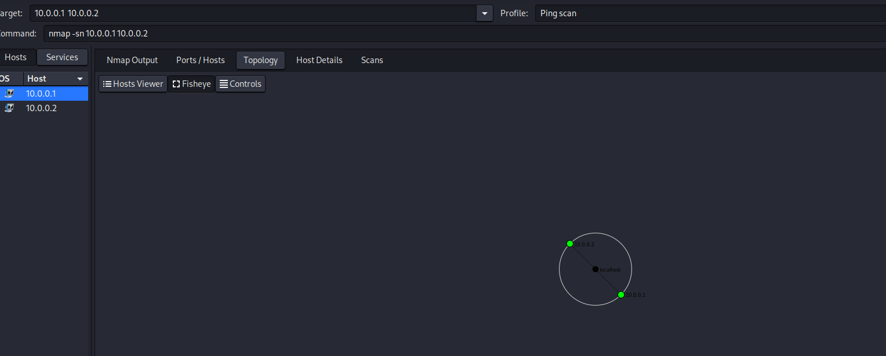
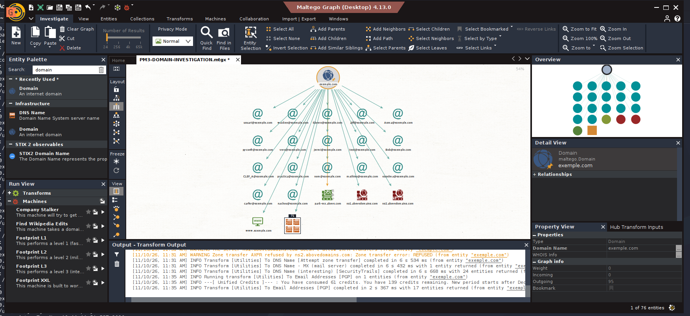

# ReconForge: OSINT & Network Discovery

### Cybersecurity Reconnaissance and Network Analysis Lab

**Author:** Hiba Gourram  
**Environment:** Kali Linux, VirtualBox  
**Project:** Networkwalks Cybersecurity Internship, Week 2

## Overview

ReconForge is a hands-on cybersecurity project focused on footprinting, open-source intelligence (OSINT), DNS reconnaissance, and network discovery.

The project documents practical exercises involving several security tools, with a focus on understanding reconnaissance methodologies, analyzing results, and preparing technical security reports.

## Project Highlights

### Network Discovery with Zenmap


### OSINT Investigation with Maltego


These screenshots document reconnaissance exercises performed in a learning environment. The findings are not evidence of verified vulnerabilities.

## Tools and Technologies

- Kali Linux
- WHOIS
- WhatWeb
- Nslookup
- Curl
- Wafw00f
- DNSRecon
- Maltego
- theHarvester
- Nmap and Zenmap
- Oracle VirtualBox

## Project Modules

### PM1: Footprinting and Reconnaissance

Practiced domain information gathering, web technology identification, DNS resolution, HTTP header analysis, WAF detection, and DNS enumeration using `example.com`.

### PM3: OSINT Investigation with Maltego

Created a domain investigation graph, executed DNS transforms, and explored publicly indexed email-related entities.

### PM4: Reconnaissance with theHarvester

Practiced certificate-transparency and multi-source information gathering.

Documented unsupported sources, missing API keys, and data-collection limitations.

### PM5: Network Discovery with Zenmap

Performed network discovery in a VirtualBox lab environment.

Verified two responding addresses:

- `10.0.0.1`: Virtual gateway
- `10.0.0.2`: Kali Linux VM

An earlier scan reported 256 responding addresses, but this result was not independently verified.

## Reproducing the Lab

### PM1: Domain Reconnaissance

The following commands were practiced against `example.com` using Kali Linux:

```bash
whois example.com
whatweb https://example.com
nslookup example.com
curl -I https://example.com
wafw00f example.com
dnsrecon -d example.com
```

### PM4: Reconnaissance with theHarvester

```bash
theHarvester -d example.com -l 50 -b crtsh
theHarvester -d example.com -l 50 -b all
```

### PM5: Network Discovery

The following commands were used in the VirtualBox lab network:

```bash
ip -4 addr show
ip route
ip neigh show
ping -c 4 10.0.0.1
ip link show eth0
sudo nmap -sn -PR 10.0.0.1 10.0.0.2
```

The PM5 exercise also used Zenmap's Ping Scan profile to visualize responding hosts and export a topology PDF.

**Scope:** These commands document educational exercises. Network scans should only be repeated on networks you own or are explicitly authorized to test.

## Challenges and Lessons Learned

### 1. Validating Network Discovery Results

During my initial Zenmap scan, Nmap reported 256 responding addresses. Rather than assuming these represented 256 physical devices, I investigated the network configuration and used additional connectivity checks. A focused scan confirmed that two selected addresses responded, while the full-subnet count remained unverified.

**Lesson:** Scanner output must be interpreted and validated before reporting conclusions.

### 2. Working with Tool Version Differences

theHarvester 4.11.1 rejected the Baidu source specified in the original exercise. I used the supported `crtsh` source to practice the alternative workflow.

**Lesson:** Security tools change over time, so compatibility and supported features should be checked.

### 3. Handling API Limitations

Some theHarvester sources returned missing API key, authentication, or parsing errors during the multi-source search.

**Lesson:** Data-source limitations affect reconnaissance completeness and should be documented transparently.

### 4. Interpreting OSINT Findings

Maltego transforms produced email-related entities and DNS relationships, but these outputs were not independently verified as active accounts or security vulnerabilities.

**Lesson:** Discovered information is not automatically a confirmed security finding.

## Key Learning Outcomes

- Understanding passive reconnaissance techniques
- Investigating DNS and domain infrastructure
- Visualizing OSINT relationships
- Performing basic network discovery
- Interpreting and validating scan results
- Documenting evidence and technical limitations
- Preparing structured cybersecurity reports

## Security and Scope

The domain-based exercises used the reserved demonstration domain `example.com`. Network scanning was performed in a virtual lab environment.

This repository documents educational reconnaissance exercises, not a completed penetration test of any third-party organization.

## Documentation

The repository includes screenshots for each module, a network topology PDF, and a full cybersecurity research report.

## Author

**Hiba Gourram**  
Cybersecurity Student | Ethical Hacking & Network Security
